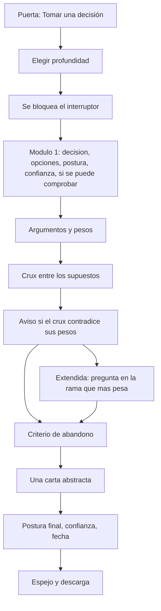

# Tomar una decisión

Esta puerta es el recorrido de decisión. No llama al modelo y no modifica «Crear algo desde cero».

La sesión vive en la página hasta que se recarga o se descarga al cerrar.

## Qué hace

La persona registra una decisión suya, marca la postura y la confianza, y arma un árbol. Cada argumento es una rama. Solo se profundiza la rama que más pesa: la que, si cae, tira la postura.

El modelo no dice qué opción conviene. La carta abstracta es una instrucción fija. La persona escribe lo que ve. Si eso no mueve ninguna carta, no entra al árbol.

## Interruptor

Se elige antes del primer módulo y queda bloqueado al empezar.

| | Normal | Extendida |
| --- | --- | --- |
| Opciones | 2 al inicio, hasta 4 | Igual |
| Argumentos | Uno a favor y uno en contra | Hasta tres por lado |
| Supuesto | Obligatorio solo en el argumento que más pesa | Igual, y además su veracidad |
| Después del crux | Criterio de abandono | Una pregunta más en esa rama, luego el criterio |
| Carta abstracta | Una, de tres instrucciones fijas | Igual |
| Cierre | Espejo: antes, después, y la carta citada si algo cambió | El mismo espejo, más el nombre del movimiento |

## Flujo

La rama de la pregunta extra solo existe en la versión extendida. En la normal, el crux pasa directo al criterio de abandono.

## Reglas que el recorrido ya aplica

- La postura es «hoy me inclino por esta». Esa es la rama que se abre.
- La confianza es un entero del 1 al 5.
- Si la decisión no se puede comprobar, no se pide el sustento en evidencia. El peso es solo cuánto se movería la decisión si el argumento fuera falso.
- Si un argumento sí se puede comprobar, ese peso se anota aparte.
- El supuesto es opcional, salvo en el argumento de mayor peso.
- Si la persona elige un crux que ella misma marcó como poco decisivo, ve un aviso y puede confirmarlo o cambiarlo. Nada corrige el contenido.
- El criterio de abandono lo escribe ella, antes de la carta abstracta.
- La carta se saca una vez, de tres instrucciones: imaginar que ya fracasó, invertir la opción, o mirarlo desde quien no elige.
- Si la postura o la confianza cambian, tiene que señalar una carta o dejar el cambio como «sin carta».
- Bajo el campo de la decisión hay un aviso: el recorrido es para una decisión propia que se puede volver a mirar. No está hecho para decisiones médicas, irreversibles, o sobre otra persona.

## Limitaciones

El aviso bajo el campo informa. No impide escribir. Alguien puede usar el recorrido para una decisión médica, irreversible, o sobre otra persona. El interruptor separa una sentada de un recorrido largo. No decide si la decisión es demasiado grave para este prototipo.

La sesión vive en la página. Recargar la pierde. Lo que queda es la descarga.

El espejo del cierre repite lo que la persona ya escribió: la postura, la confianza y, si algo cambió, la carta que señaló. No califica el razonamiento. Terminar los módulos puede sentirse como rigor, y esa sensación no es una confianza mejor calibrada.

Un cambio de confianza en una sola sesión no es calibración. La calibración compara esa confianza con lo que ocurrió después de la fecha de revisión. Esta versión no guarda esa vuelta.

El aviso del crux solo compara la carta elegida con los pesos que la persona puso. No sabe si el supuesto es cierto. Si ella confirma un crux débil, el recorrido lo respeta.

La carta abstracta es una de tres instrucciones fijas. Crea una condición para que aparezca un hallazgo. No mide qué tan sorprendente fue.

## Siguientes pasos

- Medir la sorpresa de una pregunta o una perspectiva, en la línea de la teoría de la información: si solo reafirma lo que la persona ya sabe, esa sorpresa vale cero. Buscar un grado útil, no el salto máximo.
- Un mazo más amplio de lentes. Cada lente sigue siendo una instrucción. La persona escribe el contenido.
- Guardar la vuelta de la fecha de revisión y comparar la confianza con lo que de verdad ocurrió.
- Comparar, entre varias sesiones, si los criterios de abandono se vuelven más concretos. Una sola tarde no muestra esa transferencia.
- Una retro que lea el árbol y diga algo más que el espejo. Mientras no exista, el cierre no evalúa.
- Un límite que impida el uso en decisiones médicas, irreversibles, o sobre otra persona, en lugar del aviso de ahora.
- Abrir el recorrido a decisiones banales y a decisiones muy graves solo cuando ese límite exista.
- Decir qué se conserva de una decisión y qué no, más allá de la descarga en el navegador.
- La partida al estilo Ace Attorney, si vuelve, se gana cuando el crux queda más claro o el criterio se puede observar. No cuando «tu lado» prevalece.

Queda fuera de estos pasos un agente que juzgue si el crux elegido es el correcto. El crux lo señala la persona.
